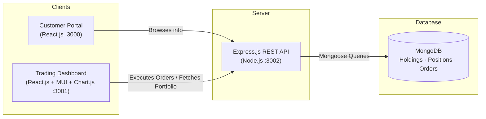

# Zerodha Clone — MERN Stack Stock Brokerage & Trading Platform

[](https://react.dev/)
[](https://nodejs.org/)
[](https://expressjs.com/)
[](https://www.mongodb.com/)
[](https://mui.com/)
[](https://www.chartjs.org/)

A full-stack financial technology web application inspired by **Zerodha Kite**. The project implements a multi-tier architecture featuring a public customer web portal, an interactive trading analytics dashboard, and a secure REST API handling stock holdings, market positions, and order execution.

---

## 📌 Table of Contents

- [Overview](#overview)
- [Architecture & Modules](#architecture--modules)
- [Key Features](#key-features)
- [Technology Stack](#technology-stack)
- [Database Schema Models](#database-schema-models)
- [API Endpoints](#api-endpoints)
- [Project Directory Structure](#project-directory-structure)
- [Getting Started](#getting-started)
  - [Prerequisites](#prerequisites)
  - [Environment Variables](#environment-variables)
  - [Installation & Running](#installation--running)
- [Future Roadmap](#future-roadmap)
- [License](#license)

---

## 🔍 Overview

Retail investors need intuitive, low-latency interfaces to monitor market movements and manage their assets. This project recreates core trading workflows of a modern discount broker:
1. **Public Discovery Portal (`frontend/`):** Informational platform showcasing products, brokerage calculator, pricing plans, and onboarding support.
2. **Trader Dashboard (`dashboard/`):** Real-time portfolio monitoring interface with dynamic charts, active position trackers, order history, and watchlist panels.
3. **Core Services Backend (`backend/`):** Scalable Express and MongoDB service orchestrating holdings calculations, order placement pipelines, and position status.

---

## 🏗️ Architecture & Modules

The repository is structured into three distinct packages:



---

## 🚀 Key Features

* **Real-time Portfolio Overview:** Calculates total investment value, current valuation, and net P&L percentage dynamically.
* **Interactive Equity Visualizations:** Rendered using **Chart.js** and **react-chartjs-2** for graphical distribution of invested funds.
* **Order Management System (OMS):** Supports placing equity BUY and SELL orders with real-time state updates.
* **Holdings & Positions Tracking:** Granular breakdown of overnight holdings versus intraday positions with gain/loss indicators.
* **Component-Driven UI:** Styled with **Material-UI (MUI)** and responsive CSS for consistent typography and spacing.

---

## 🛠️ Technology Stack

| Layer | Technologies |
| :--- | :--- |
| **Frontend Portal** | React.js (v18), React Router DOM (v6), Responsive CSS |
| **Trading Dashboard** | React.js (v18), Material-UI (`@mui/material`), Chart.js, `react-chartjs-2`, Axios |
| **Backend API** | Node.js, Express.js (v4), Body-Parser, CORS, Dotenv |
| **Authentication** | Passport.js, `passport-local`, `passport-local-mongoose` |
| **Database & ODM** | MongoDB, Mongoose (v8) |
| **Tooling** | Nodemon, Git, npm |

---

## 🗄️ Database Schema Models

The backend utilizes **Mongoose** models to manage trading entities:

### 1. `HoldingsSchema`
Represents long-term investments held in the demat account:
* `name` *(String)*: Asset ticker / Company name (e.g., `RELIANCE`, `INFY`)
* `qty` *(Number)*: Quantity of shares owned
* `avg` *(Number)*: Average buy price
* `price` *(Number)*: Current market price (CMP)
* `net` *(String)*: Net percentage gain or loss
* `day` *(String)*: Day's gain or loss percentage

### 2. `PositionsSchema`
Represents open intraday or derivative contracts:
* `product` *(String)*: Product category (e.g., CNC, MIS)
* `name` *(String)*: Instrument identifier
* `qty`, `avg`, `price`, `net`, `day`: Positional state
* `isLoss` *(Boolean)*: Indicator flag for styling negative delta

### 3. `OrdersSchema`
Represents submitted market orders:
* `name` *(String)*: Instrument ticker
* `qty` *(Number)*: Executed share quantity
* `price` *(Number)*: Order execution price
* `mode` *(String)*: Order direction (`BUY` or `SELL`)

---

## 📡 API Endpoints

| Method | Endpoint | Description |
| :--- | :--- | :--- |
| `GET` | `/allHoldings` | Retrieve all current stock holdings for the user |
| `GET` | `/allPositions` | Retrieve all active intraday positions |
| `POST` | `/newOrder` | Place and record a new BUY/SELL market order |

---

## 📂 Project Directory Structure

```text
Zerodha-Clone/
├── backend/
│   ├── model/
│   │   ├── HoldingsModel.js
│   │   ├── PositionsModel.js
│   │   └── OrdersModel.js
│   ├── schemas/
│   │   ├── HoldingsSchema.js
│   │   ├── PositionsSchema.js
│   │   └── OrdersSchema.js
│   ├── index.js              # Express app & route declarations
│   ├── package.json
│   └── .env
├── dashboard/                # Trading Dashboard (React 18 + MUI)
│   ├── public/
│   ├── src/
│   │   ├── components/       # Watchlist, Holdings, Positions, Orders
│   │   └── App.js
│   └── package.json
└── frontend/                 # Marketing & Customer Portal
    ├── public/
    ├── src/                  # Landing, Products, Pricing, Support
    └── package.json
```

---

## 💻 Getting Started

### Prerequisites
* **Node.js** (v18.0.0 or higher recommended)
* **npm** (v9.0.0 or higher)
* **MongoDB** (Local instance or MongoDB Atlas connection URI)

### Environment Variables
Create a `.env` file in the `backend/` directory:

```env
PORT=3002
MONGO_URL=mongodb+srv://<username>:<password>@cluster.mongodb.net/zerodha_clone?retryWrites=true&w=majority
```

### Installation & Running

#### 1. Start the Backend API:
```bash
cd backend
npm install
npm start
```
*Backend runs by default on `http://localhost:3002`.*

#### 2. Start the Trading Dashboard:
```bash
cd ../dashboard
npm install
npm start
```
*Dashboard opens on `http://localhost:3001` (or next available port).*

#### 3. Start the Customer Portal:
```bash
cd ../frontend
npm install
npm start
```
*Frontend opens on `http://localhost:3000`.*

---

## 🗺️ Future Roadmap

- [ ] **Live Market Data Feed:** Integration with WebSockets for tick-by-tick real-time price updates.
- [ ] **Order Book Depth:** Multi-depth bid/ask visualization widget.
- [ ] **JWT Authentication:** Session token rotation and role-based access control.
- [ ] **Automated Tests:** Unit and integration testing with Vitest and Supertest.

---

## 📄 Author & License

* **Author:** [Mohit Mulik](https://github.com/MohitMulik)
* **License:** Licensed under the [MIT License](LICENSE).
